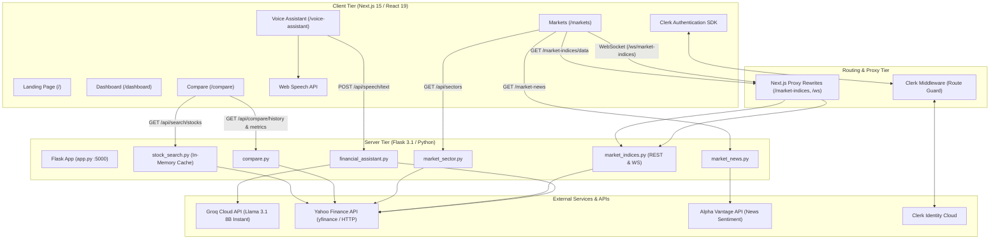

# Voice-Powered Stock Market Assistant

**Voice-Powered Stock Market Assistant** is an AI-powered financial market intelligence web application and voice assistant. The platform combines browser-based speech recognition, Large Language Models (LLMs), and financial data streaming to provide real-time stock insights, interactive multi-asset comparisons, global market index tracking, sector performance analysis, and financial news sentiment feeds.

---

## Table of Contents

- [Project Overview](#project-overview)
- [Problem Statement](#problem-statement)
- [Proposed Solution](#proposed-solution)
- [Key Features](#key-features)
- [How It Works (Step-by-Step)](#how-it-works-step-by-step)
- [System Architecture](#system-architecture)
- [Technology Stack](#technology-stack)
- [Project Structure](#project-structure)
- [Technical Implementation](#technical-implementation)
  - [Backend Architecture (`backend_py`)](#backend-architecture-backend_py)
  - [Frontend Architecture (`frontend`)](#frontend-architecture-frontend)
  - [AI & Market Intelligence Pipeline](#ai--market-intelligence-pipeline)
  - [Data Ingestion & Caching](#data-ingestion--caching)
- [Installation & Setup](#installation--setup)
  - [Prerequisites](#prerequisites)
  - [Backend Installation](#backend-installation)
  - [Frontend Installation](#frontend-installation)
- [Environment Configuration](#environment-configuration)
- [How to Run](#how-to-run)
- [Usage Instructions](#usage-instructions)
- [Example Input and Output](#example-input-and-output)
- [API Documentation](#api-documentation)
  - [Health Endpoints](#health-endpoints)
  - [Financial Assistant Endpoint](#financial-assistant-endpoint)
  - [Market Indices Endpoints](#market-indices-endpoints)
  - [Market Sectors Endpoint](#market-sectors-endpoint)
  - [Stock Comparison Endpoints](#stock-comparison-endpoints)
  - [Stock Search Endpoint](#stock-search-endpoint)
  - [Market News Endpoint](#market-news-endpoint)
- [Database & Data Management](#database--data-management)
- [Testing & Verification](#testing--verification)
- [Actual Project Metrics](#actual-project-metrics)
- [Current Implementation Status](#current-implementation-status)
- [Limitations & Known Issues](#limitations--known-issues)
- [Future Improvements](#future-improvements)
- [Contributing](#contributing)
- [Team Members & Acknowledgements](#team-members--acknowledgements)
- [License](#license)

---

## Project Overview

Voice-Powered Stock Market Assistant is structured as a decoupled full-stack application composed of:
1. **A Next.js 15 client (`frontend/`)**: Built using React 19, TypeScript, Tailwind CSS v4, Lucide icons, Recharts, and Shadcn UI primitives, with user authentication managed via Clerk.
2. **A Python Flask unified server (`backend_py/`)**: Serving REST and WebSocket endpoints powered by `yfinance`, Alpha Vantage, and Groq Cloud's `llama-3.1-8b-instant` model.

The platform provides a dual modality for market research: users can either query the market through spoken or typed natural language, or explore data visually through dedicated dashboards, comparison charts, and sector heatmaps.

---

## Problem Statement

Navigating financial markets presents steep barriers for individual investors and non-technical traders:
- **Interface Complexity**: Traditional trading platforms and financial terminals present overwhelming tables, jargon, and complex charting tools that are difficult to operate quickly.
- **Fragmented Data**: Investors must frequently juggle multiple platforms—one for quotes, another for news, a third for sector trends, and a fourth for fundamental ratios.
- **Inflexible Interaction**: Standard platforms require manual keyboard searching and precise ticker knowledge. Users who do not know the exact ticker symbol (e.g., searching for "Google" instead of `GOOGL` or "Reliance" instead of `RELIANCE.NS`) face search failure or manual lookups.
- **Lack of Immediate Context**: Raw stock numbers lack instant analytical interpretation. An investor seeing a sudden 3% dip often lacks immediate summary context explaining key ratios, day ranges, and performance trends in plain English.

---

## Proposed Solution

Voice-Powered Stock Market Assistant addresses these challenges by integrating natural language processing with automated data aggregation:
- **Voice-First Conversational Agent**: Users speak queries naturally. The browser captures speech via the Web Speech API and forwards the transcript to the Flask backend.
- **Automatic Entity Resolution**: The backend dynamically maps colloquial company names to their correct market tickers and extracts uppercase stock symbols using regular expressions.
- **Context-Augmented Financial Prompting**: Before invoking the Groq LLM, the backend queries real-time intraday data (price, day range, volume, P/E ratio, market cap, sector) and injects this live context into the system prompt, preventing hallucinated prices and outdated answers.
- **Unified Visual Dashboards**: Live market indices (India, USA, Europe, Asia), S&P 500 sector ETF performance, paginated financial news with heuristic sentiment scoring, and multi-symbol normalized comparison charts are brought together into a single web application.
- **Managed Authentication**: Clerk provides user registration, email/password login, OAuth SSO, and route-level protection.

---

## Key Features

### 1. AI Voice & Text Financial Assistant (`/voice-assistant`)
- **Speech Recognition**: Voice input via native browser Web Speech API (`SpeechRecognition` / `webkitSpeechRecognition`) with visual listening feedback.
- **Text Fallback**: Full keyboard input support with multiline textarea and Enter-to-submit handling.
- **Live Context Injection**: Automatically enriches LLM queries with real-time stock fundamentals and intraday performance from Yahoo Finance.
- **Formatted Responses**: Returns plain-text market analysis, explicitly prefixing positive gains with `(+)` and negative losses with `(-)` for readability.
- **Backend Health Awareness**: Displays client-side connectivity banners when the backend server is unreachable.

### 2. Global Market Indices Tracking (`/markets`)
- **Multi-Region Coverage**: Tracks 21 benchmark indices across 4 geographic regions:
  - **India**: Nifty 50 (`^NSEI`), BSE Sensex (`^BSESN`), Nifty Midcap 150 (`NIFTYMIDCAP150.NS`), Nifty Bank (`NIFTYBANK.NS`), Nifty IT (`NIFTYIT.NS`), Nifty Pharma (`CNXPHARMA.NS`).
  - **USA**: S&P 500 (`^GSPC`), NASDAQ (`^IXIC`), Dow Jones (`^DJI`), Russell 2000 (`^RUT`), CBOE Volatility Index (`^VIX`).
  - **Asia**: Nikkei 225 (`^N225`), Hang Seng (`^HSI`), SSE Composite (`000001.SS`), KOSPI (`^KS11`), Taiwan Weighted (`^TWII`), Straits Times (`^STI`).
  - **Europe**: FTSE 100 (`^FTSE`), DAX (`^GDAXI`), CAC 40 (`^FCHI`), EURO STOXX 50 (`^STOXX50E`).
- **Real-Time Data Streaming**: Serves live data via WebSocket (`/ws/market-indices`) every 10 seconds, supplemented by on-demand REST polling (`/market-indices/data`).

### 3. S&P 500 Sector ETF Performance (`/markets`)
- **Sector Coverage**: Evaluates 11 primary SPDR sector ETFs plus the SPY benchmark (XLK, XLF, XLY, XLV, XLC, XLI, XLP, XLE, XLB, XLRE, XLU).
- **Multi-Horizon Calculations**:
  - **Intraday Change**: Calculated from 1-minute intraday bars.
  - **Daily Change**: Calculated from 2-day closing prices.
  - **Year-To-Date (YTD) Change**: Calculated from the first trading day of the calendar year.
- **Visual Weighting**: Renders sector index weight percentages using proportional progress bars with green/red directional indicators.

### 4. Financial News & Sentiment Feed (`/markets`)
- **Alpha Vantage Integration**: Fetches top financial news headlines, summaries, source metadata, and banner images via Alpha Vantage's `NEWS_SENTIMENT` API.
- **Client-Side Keyword Search**: Instant filtering across article titles and news publishers.
- **Regex Ticker Extraction**: Dynamically identifies mentioned equity tickers in article headlines and summaries.
- **Rule-Based Sentiment Analysis**: Applies a keyword evaluation algorithm to tag articles as `Positive`, `Negative`, or `Neutral`.
- **Client-Side Pagination**: Clean 5-article pagination with ellipsis navigation.

### 5. Multi-Stock Comparison Engine (`/compare`)
- **Debounced Auto-Complete Search**: Queries Yahoo Finance search API with 300ms debounce and active request cancellation via `AbortController`.
- **Multi-Asset Selection**: Allows dynamic addition and removal of ticker tags.
- **3-Day Trend Analysis**: Classifies short-term price movement into `Uptrend`, `Downtrend`, or `Neutral` status badges.
- **Interactive Multi-Chart Visualizations**: Rendered using Recharts:
  - **Chart Modes**: Line, Area, and Bar charts.
  - **Timeframe Selector**: 1D, 1W, 1M, 3M, 6M, 1Y, 5Y.
  - **Normalized Mode**: Toggles between absolute dollar price (`$`) and percentage change (`%`) normalized to the start of the timeframe.
- **Fundamental Metrics Table**: Compares Market Cap, P/E Ratio, EPS, Dividend Yield, Beta, 52-Week High, and 52-Week Low with descriptive tooltips, status badges, and relative progress bars.
- **Historical Price Log**: Tabbed daily pricing table displaying Date, Close, Daily Dollar Change, Daily Percent Change, Volume, and Day Range indicators.

### 6. User Authentication & Profile (`/dashboard`, `/profile`)
- **Clerk Identity Platform**: Pre-configured authentication middleware protecting all application routes except the public landing page.
- **SSO Callback Handler**: Handles OAuth callback redirections at `/sso-callback`.
- **Account Management**: Embedded Clerk `<UserProfile />` at `/profile` for account details and security settings.
- **Theme Switching**: Dark, light, and system theme switching powered by `next-themes` and Tailwind CSS v4 variables.

---

## How It Works (Step-by-Step)

### Conversational Voice Assistant Lifecycle

```
[User speaks query]
       │
       ▼
[Web Speech API (Browser)] ──(Transcribes speech to text)──► [VoiceInterface Component]
                                                                     │
                                                             (POST /api/speech/text)
                                                                     │
                                                                     ▼
                                                          [Flask Backend: app.py]
                                                                     │
                                                        [financial_assistant.py]
                                                                     │
                             ┌───────────────────────────────────────┴───────────────────────────────┐
                             │                                                                       │
                [Recognized Ticker / Regex Match]                                           [No Ticker Detected]
                             │                                                                       │
                             ▼                                                                       ▼
             [Query yfinance for 1-Day History]                                          [Standard Financial Prompt]
                             │                                                                       │
                             ▼                                                                       │
              [Format Financial Context Block]                                                       │
              (Price, Change, High, Low, Volume, P/E)                                                │
                             │                                                                       │
                             └───────────────────────────────────────┬───────────────────────────────┘
                                                                     │
                                                                     ▼
                                                          [Query Groq Cloud API]
                                                      (Model: llama-3.1-8b-instant)
                                                                     │
                                                                     ▼
                                                         [Sanitize & Format Text]
                                                                     │
                                                                     ▼
                                                         [Return JSON Response]
                                                                     │
                                                                     ▼
                                                       [Render in UI with Badges]
```

1. **Audio Capture**: The user activates the microphone button in `voice-interface.tsx`. The browser's native `SpeechRecognition` instance listens continuously and captures interim and final transcript strings.
2. **Transmission**: When speech pauses, the client sends a JSON payload `{"text": "..."}` to the Flask endpoint `POST /api/speech/text`.
3. **Entity Resolution**:
   - The backend checks a dictionary of 60 predefined colloquial company names (e.g. "apple" $\rightarrow$ `AAPL`, "reliance" $\rightarrow$ `RELIANCE.NS`, "dow jones" $\rightarrow$ `^DJI`).
   - If no dictionary match occurs, a regular expression extracts capital ticker patterns (`\b[A-Z]{1,5}\b`) and verifies their validity against `yfinance`.
4. **Data Augmentation**: If a ticker is resolved, `yf.Ticker(ticker)` fetches live intraday market data: closing price, dollar change, percentage change, day high, day low, trading volume, market capitalization, trailing P/E ratio, sector, and industry.
5. **LLM Generation**: The enriched prompt is sent via HTTPS to the Groq Chat Completions API with temperature set to `0.5` and token limit `800`.
6. **Sanitization**: The backend removes bold markdown asterisks (`**`) and preserves signed percentage changes (`+X.XX%`, `-X.XX%`) for clean display in the chat UI.
7. **Display**: The response displays in the chat thread, highlighting market data snippets with badge tags.

---

## System Architecture



---

## Technology Stack

### Languages & Runtimes
| Technology | Version | Purpose |
| :--- | :--- | :--- |
| **TypeScript** | `^5` | Strongly-typed client application logic |
| **JavaScript (ES Modules)** | Next.js runtime | Next.js configuration and build execution |
| **Python** | `3.11.9` (Compatible $\ge 3.10$) | Unified backend service and data ingestion |
| **Node.js** | `>= 18.0.0` (Verified on `v22.21.0`) | Frontend build engine and package execution |

### Frontend Framework & UI Libraries
| Library | Version | Purpose |
| :--- | :--- | :--- |
| **Next.js** | `15.3.0` | App Router framework with Turbopack support |
| **React** | `^19.0.0` | Core UI rendering library |
| **React DOM** | `^19.0.0` | DOM rendering bindings |
| **Tailwind CSS** | `^4.0.0` | Utility-first CSS framework with `@tailwindcss/postcss` |
| **Radix UI Primitives** | Various (`^1.1.3` - `^2.1.7`) | Accessible dialogs, dropdowns, tabs, popovers, select, progress bars |
| **Recharts** | `^2.15.2` | SVG charting library for stock comparison charts |
| **Lucide React** | `^0.487.0` | Application icon set |
| **Sonner** | `^2.0.3` | Toast notifications |
| **Embla Carousel React** | `^8.6.0` | Carousel UI components |
| **cmdk** | `^1.1.1` | Command menu and auto-complete dropdown for stock search |
| **next-themes** | `^0.4.6` | Theme management (light, dark, system mode) |

### Backend Framework & Python Libraries
| Library | Version | Purpose |
| :--- | :--- | :--- |
| **Flask** | `3.1.0` | Lightweight HTTP server and API routing |
| **Flask-CORS** | `5.0.1` | Cross-Origin Resource Sharing handling |
| **Flask-Sock** | `0.7.0` | WebSocket routing over Flask using `simple-websocket` |
| **yfinance** | `0.2.55` | Yahoo Finance scraper for market indices, sectors, and quotes |
| **requests** | `2.31.0` | HTTP requests to Groq, Alpha Vantage, and Yahoo Finance search |

### External APIs & Cloud Services
| Service | Provider | Purpose |
| :--- | :--- | :--- |
| **Llama 3.1 8B Instant** | Groq Cloud | Low-latency LLM inference for financial market responses |
| **Authentication & IAM** | Clerk | User registration, session tokens, SSO callbacks, user profile |
| **Market Data** | Yahoo Finance | Free tier real-time and historical equity quotes |
| **Market News Sentiment** | Alpha Vantage | Financial news sentiment endpoint |

---

## Project Structure

```
Voice_Powered_Stock_Market_Assistant/   # Project root directory (Voice-Powered Stock Market Assistant)
├── .gitignore                          # Git ignore rules for Node and Python artifacts
├── README.md                           # Master technical project documentation
│
├── backend_py/                         # Python Flask Backend Service
│   ├── .env                            # Backend environment configuration (GROQ_API_KEY)
│   ├── app.py                          # Unified server entry point, CORS, routes & health check
│   ├── requirements.txt                # Pinned Python package dependencies
│   └── tools/                          # Backend tool implementations
│       ├── __init__.py                 # Python package marker
│       ├── compare.py                  # Stock comparison history and metrics endpoints
│       ├── financial_assistant.py      # Voice/Text assistant logic, Groq LLM prompt & yfinance context
│       ├── market_indices.py           # Multi-region index tracking (REST & WebSocket /ws/market-indices)
│       ├── market_news.py              # Alpha Vantage news sentiment ingestion endpoint
│       ├── market_sector.py            # S&P 500 SPDR ETF sector performance (Intraday, Daily, YTD)
│       └── stock_search.py             # Yahoo Finance stock auto-complete search with in-memory caching
│
└── frontend/                           # Next.js 15 Client Application
    ├── .env.local                      # Client environment configuration (Clerk keys)
    ├── components.json                 # Shadcn UI CLI configuration
    ├── eslint.config.mjs               # ESLint 9 configuration
    ├── metadata.ts                     # Default application metadata definition
    ├── next.config.ts                  # Next.js build options & proxy rewrite rules
    ├── package.json                    # Frontend dependencies and npm scripts
    ├── package-lock.json               # Deterministic dependency lockfile
    ├── postcss.config.mjs              # PostCSS plugins for Tailwind CSS v4
    ├── tsconfig.json                   # TypeScript compiler configuration
    └── src/
        ├── middleware.ts               # Clerk route-protection middleware
        ├── app/                        # Next.js App Router directory
        │   ├── globals.css             # Global Tailwind theme variables and CSS keyframes
        │   ├── layout.tsx              # Root HTML layout with ClerkProvider & ThemeProvider
        │   ├── page.tsx                # Public home landing page
        │   ├── compare/
        │   │   └── page.tsx            # Multi-stock comparison page
        │   ├── dashboard/
        │   │   └── page.tsx            # Central investor dashboard
        │   ├── markets/
        │   │   └── page.tsx            # Global market indices, sectors, and news page
        │   ├── profile/
        │   │   └── page.tsx            # Clerk user profile management page
        │   ├── sso-callback/
        │   │   └── page.tsx            # Clerk OAuth SSO redirect handler page
        │   └── voice-assistant/
        │       └── page.tsx            # Full-screen conversational voice assistant page
        ├── components/
        │   ├── theme-provider.tsx      # NextThemes wrapper component
        │   ├── theme-toggle.tsx        # Light/Dark mode switcher dropdown
        │   ├── compare/                # Stock comparison components
        │   │   ├── compare-chart.tsx        # Recharts Line/Area/Bar multi-series visualization
        │   │   ├── compare-container.tsx    # Standalone comparison wrapper (localStorage-backed)
        │   │   ├── comparison-history.tsx   # Per-ticker historical tabular data log
        │   │   ├── comparison-metrics.tsx   # Fundamental financial metrics comparison table
        │   │   ├── performance-summary.tsx  # Short-term trend cards (Uptrend/Downtrend)
        │   │   └── stock-search.tsx         # Debounced stock search command input
        │   ├── dashboard/
        │   │   └── stock-list.tsx      # Static watchlist component for dashboard
        │   ├── home/                   # Landing page components
        │   │   ├── authentication.tsx  # Authentication features showcase
        │   │   ├── call-to-action.tsx  # Conversion prompt section
        │   │   ├── hero-section.tsx    # Hero section with voice interaction illustration
        │   │   ├── key-features.tsx    # Grid of core application capabilities
        │   │   └── market.tsx          # Landing page market summary preview
        │   ├── layout/                 # Layout components
        │   │   ├── chat-layout.tsx     # Voice assistant layout with collapsible sidebar
        │   │   ├── footer.tsx          # Global footer with navigation links
        │   │   ├── layout-wrapper.tsx  # Route guard wrapper with navbar visibility logic
        │   │   └── navbar.tsx          # Top navigation bar with Clerk UserButton & theme toggle
        │   ├── market/                 # Market observation components
        │   │   ├── market-indices.tsx  # Global indices regional tabs (10s polling)
        │   │   ├── market-news.tsx     # Paginated financial news with sentiment tags
        │   │   ├── market-sectors.tsx  # Sector ETF progress bars (30s polling)
        │   │   └── market-summary.tsx  # Indian market card with WebSocket connection
        │   ├── ui/                     # Shadcn / Radix UI component library (30+ primitives)
        │   └── voice-assistant/        # Voice assistant components
        │       ├── chat-input.tsx      # Standalone chat input component
        │       ├── chat-sidebar.tsx    # Collapsible sidebar with navigation and profile
        │       ├── chat-user.tsx       # Sidebar user profile button with dropdown
        │       ├── message-display.tsx # Standalone message list renderer
        │       ├── response-display.tsx# Standalone response card with 5-day sparkline
        │       ├── transcript-display.tsx# Standalone transcript bubble
        │       ├── voice-input.tsx     # Web Speech API microphone toggle button
        │       └── voice-interface.tsx # Integrated voice chat interface
        ├── hooks/
        │   ├── use-mobile.ts           # Mobile viewport detection hook (<768px)
        │   └── useMarketIndices.ts     # Standalone WebSocket market indices hook
        ├── lib/
        │   └── utils.ts                # Tailwind clsx/twMerge utility function
        └── types/
            └── chat.ts                 # Chat message TypeScript interface
```

---

## Technical Implementation

### Backend Architecture (`backend_py`)

The Flask application initializes in `backend_py/app.py`. It attaches Cross-Origin Resource Sharing (`CORS(app)`) to support requests from the Next.js development server on `http://localhost:3000`. WebSocket support is attached via `Sock(app)`.

The backend delegates specific responsibilities to modular tool files:

1. **`financial_assistant.py`**:
   - Manages speech-to-text queries.
   - Contains a lookup dictionary of 60 corporate names and indices.
   - Resolves unmatched queries using regular expressions (`\b[A-Z]{1,5}\b`) and verifies them through `yfinance`.
   - Queries Groq Cloud's OpenAI-compatible endpoint (`https://api.groq.com/openai/v1/chat/completions`) using the `llama-3.1-8b-instant` model.
   - Post-processes responses by stripping markdown formatting (`**`) and preserving signed values (`+2.45%`, `-1.12%`).

2. **`market_indices.py`**:
   - Maintains a catalog of 21 market indices across India, Asia, USA, and Europe.
   - Iterates through tickers with a 0.2-second pause between requests to prevent upstream rate limiting.
   - Exposes both a REST endpoint (`/market-indices/data`) and a WebSocket endpoint (`/ws/market-indices`), which broadcasts updated indices every 10 seconds.

3. **`market_sector.py`**:
   - Maps 11 economic sectors to their corresponding SPDR ETFs (`XLK`, `XLF`, `XLY`, `XLV`, `XLC`, `XLI`, `XLP`, `XLE`, `XLB`, `XLRE`, `XLU`) and the `SPY` benchmark.
   - Calculates 3 temporal change values: Intraday (from 1m intervals), Daily (from 2d close), and YTD (from Jan 1 to current date).

4. **`compare.py`**:
   - Handles multi-symbol parameter lists (`?symbols=AAPL&symbols=MSFT`).
   - Extracts historical closing prices and volumes across requested timeframes (`1d`, `1wk`, `1mo`, `3mo`, `6mo`, `1y`, `5y`).
   - Gathers fundamental company metrics: `marketCap`, `trailingPE`, `trailingEps`, `dividendYield`, `beta`, `fiftyTwoWeekHigh`, and `fiftyTwoWeekLow`.

5. **`stock_search.py`**:
   - Interfaces directly with Yahoo Finance's search API.
   - Concurrently retrieves real-time pricing and percentage change for up to 8 equity results using Python's `concurrent.futures.ThreadPoolExecutor(max_workers=5)`.
   - Uses an in-memory dictionary cache with a 300-second (5-minute) expiration to reduce repeated upstream queries.

6. **`market_news.py`**:
   - Queries Alpha Vantage's `NEWS_SENTIMENT` endpoint for finance topics.
   - Normalizes raw JSON feeds into simplified objects (`title`, `summary`, `url`, `banner_image`, `source`).

### Frontend Architecture (`frontend`)

1. **App Router & Layout Hierarchy**:
   - `src/app/layout.tsx` wraps all components with `<ClerkProvider>` and `<ThemeProvider>`.
   - `src/components/layout/layout-wrapper.tsx` controls global header visibility (hiding the navbar on `/voice-assistant`) and enforces authentication: unauthenticated users accessing `/dashboard`, `/markets`, `/compare`, or `/voice-assistant` are redirected to Clerk's sign-in modal.
2. **Proxy Rewrites (`next.config.ts`)**:
   - Rewrites `/market-indices/:path*` to `http://localhost:5000/market-indices/:path*`.
   - Rewrites `/ws/:path*` to `http://localhost:5000/ws/:path*`.
3. **Voice Interface Component (`voice-interface.tsx`)**:
   - Mounts speech recognition listeners.
   - Manages auto-scroll behavior via React `useRef` as new messages arrive.
   - Performs a pre-flight health check against `http://localhost:5000/health` on initial load.
4. **Data Visualization (`compare-chart.tsx`)**:
   - Merges multiple independent time-series arrays into a unified date-aligned array.
   - Calculates normalized percentage changes:
     $$\text{Normalized Value}_t = \left( \frac{\text{Price}_t - \text{Price}_0}{\text{Price}_0} \right) \times 100$$
   - Renders Recharts `<ResponsiveContainer>` containing `<LineChart>`, `<AreaChart>`, or `<BarChart>` based on active UI tabs.

### AI & Market Intelligence Pipeline

The financial assistant avoids hallucinated figures by fetching real-time market data **before** querying the language model:

```
User Query: "How is Apple stock performing today?"
                    │
                    ▼
     [Extracted Ticker: "AAPL"]
                    │
                    ▼
[yfinance Intraday Query: Price: $181.56, Change: +$2.45 (+1.37%), Range: $179.20 - $182.00, Vol: 54,231,000, P/E: 28.5]
                    │
                    ▼
[Prompt Assembled with System Role + Context + Query]
                    │
                    ▼
[Groq LLM generates analysis grounded in the injected data]
```

### Data Ingestion & Caching

- **Search Cache**: Stock search queries are stored in an in-memory dictionary in `stock_search.py`. Repeated queries within 300 seconds resolve instantly from memory.
- **REST Polling**:
  - Global Market Indices poll every 10,000 ms (10 seconds).
  - Market Sectors poll every 30,000 ms (30 seconds).
- **WebSocket Streaming**: Indian market indices stream continuous JSON updates over WebSocket every 10 seconds.

---

## Installation & Setup

### Prerequisites

Ensure the following tools are installed on your machine:
- **Node.js**: Version `18.0.0` or higher (verified on `v22.21.0`).
- **npm**: Version `9.0.0` or higher (verified on `10.9.4`).
- **Python**: Version `3.10` or `3.11` (verified on `3.11.9`).
- **Git**: Installed and configured.

### 1. Clone the Repository

```bash
git clone https://github.com/KrishPatel-AI/Voice_Powered_Stock_Market_Assistant.git
cd Voice_Powered_Stock_Market_Assistant
```

### 2. Backend Installation

1. Navigate to the backend directory:
   ```bash
   cd backend_py
   ```

2. Create and activate a Python virtual environment:
   - **Windows (Command Prompt / PowerShell):**
     ```powershell
     python -m venv venv
     .\venv\Scripts\Activate.ps1
     ```
   - **macOS / Linux:**
     ```bash
     python3 -m venv venv
     source venv/bin/activate
     ```

3. Install the required dependencies:
   ```bash
   pip install -r requirements.txt
   ```

> [!NOTE]
> `backend_py/tools/stock_search.py` contains an unused import (`from bs4 import BeautifulSoup`). If your Python environment raises a `ModuleNotFoundError: No module named 'bs4'`, install `beautifulsoup4` via `pip install beautifulsoup4` or remove the unused import statement from `stock_search.py`.

### 3. Frontend Installation

1. Open a new terminal and navigate to the frontend directory:
   ```bash
   cd frontend
   ```

2. Install dependencies via npm:
   ```bash
   npm install
   ```

---

## Environment Configuration

### Backend Environment (`backend_py/.env`)

Create or update `backend_py/.env` with your API credentials:

```env
# Port for Flask unified server (Defaults to 5000 if omitted)
PORT=5000

# Groq Cloud API Key for Llama 3.1 LLM inference
# Obtain key at: https://console.groq.com/keys
GROQ_API_KEY=your_groq_api_key_here

# Optional: Alpha Vantage API Key for financial news sentiment
# Obtain free key at: https://www.alphavantage.co/support/#api-key
ALPHA_VANTAGE_API_KEY=your_alpha_vantage_api_key_here
```

### Frontend Environment (`frontend/.env.local`)

Create or verify `frontend/.env.local` with your Clerk credentials:

```env
# Clerk Authentication Keys
# Obtain keys at: https://dashboard.clerk.com
NEXT_PUBLIC_CLERK_PUBLISHABLE_KEY=pk_test_your_clerk_publishable_key
CLERK_SECRET_KEY=sk_test_your_clerk_secret_key

# Optional: Backend URL override (Defaults to http://localhost:5000)
NEXT_PUBLIC_BACKEND_URL=http://localhost:5000
```

> [!CAUTION]
> Never commit `.env` or `.env.local` files containing production credentials to version control. Both filenames are included in the repository `.gitignore`.

---

## How to Run

Running Voice-Powered Stock Market Assistant requires two active terminal windows.

### Terminal 1: Run Backend Server

```bash
cd backend_py
# Activate your virtual environment if not already active
# Windows: .\venv\Scripts\Activate.ps1 | macOS/Linux: source venv/bin/activate
python app.py
```

The Flask server will start on `http://localhost:5000`:
```
 * Serving Flask app 'app'
 * Debug mode: on
✅ Financial Assistant tool initialized
✅ Market Indices tool initialized with focus on Indian markets
✅ Sector Performance tool initialized
✅ Market News tool initialized
 * Running on http://127.0.0.1:5000
```

Verify backend health by visiting: `http://localhost:5000/health`.

### Terminal 2: Run Frontend Development Server

```bash
cd frontend
npm run dev
```

The Next.js application will compile using Turbopack and start on `http://localhost:3000`.

Open your browser and navigate to: **`http://localhost:3000`**.

---

## Usage Instructions

### Navigating the Application

1. **Sign Up / Log In**:
   - Click **Log In** or **Sign Up** in the top navigation bar.
   - Authenticate using email or your preferred OAuth provider via the Clerk modal.
2. **Accessing the Dashboard (`/dashboard`)**:
   - View your simulated portfolio allocation, quick watchlist, market pulse summary, and recent financial headlines.
3. **Using the Voice Assistant (`/voice-assistant`)**:
   - Click the microphone icon to activate voice listening (grant microphone permissions in your browser when prompted).
   - Speak your financial question clearly (e.g., *"How is Tesla performing today?"*).
   - Click the microphone again to stop listening, or simply type your query in the message box and press `Enter`.
   - The assistant returns real-time market data and an analytical summary.
4. **Exploring Global Markets (`/markets`)**:
   - Check the **Market Overview** tab to view live values for Indian, Asian, US, and European market indices.
   - Review the **Market Sectors** column to evaluate real-time sector ETF performance.
   - Read headlines in the **Market News** section, filter articles using the search box, and click the external link icon to read full articles.
5. **Comparing Stocks (`/compare`)**:
   - Type a stock symbol (e.g., `NVDA`, `AMD`, `INTC`) in the search box.
   - Click an auto-complete suggestion or press **Add Symbol**.
   - Switch between **Charts**, **Metrics**, and **History** tabs.
   - Toggle **Compare % Change** to normalize prices to a common percentage scale.

---

## Example Input and Output

### Conversational Voice Assistant

#### Query 1: Single Equity Query
- **User Input (Voice/Text)**: *"What is the current stock price and performance of Apple?"*
- **Backend Context Assembled**:
  ```
  Current data for Apple Inc. (AAPL):
  Price: $181.56 USD
  Change: +2.45 (+1.37%)
  Day Range: $179.20 - $182.00
  Volume: 54,231,000
  Market Cap: $2,800,000,000,000
  P/E Ratio: 28.5
  Sector: Technology
  Industry: Consumer Electronics
  ```
- **Assistant Response**:
  ```
  Apple Inc. (AAPL) is currently trading at $181.56 USD, showing an intraday gain of (+1.37%) or +$2.45.
  The stock has traded between $179.20 and $182.00 today with a volume of approximately 54.2 million shares.
  With a trailing P/E ratio of 28.5 and a market cap of approximately $2.80 trillion, Apple demonstrates stable performance in the Technology sector.
  ```

#### Query 2: General Market/Economic Query
- **User Input**: *"What is the difference between a bull and a bear market?"*
- **Assistant Response**:
  ```
  A bull market occurs when securities prices are rising or are expected to rise over a sustained period, typically accompanied by investor optimism and economic growth.
  In contrast, a bear market describes a market condition where prices drop 20% or more from recent highs, often driven by widespread pessimism and economic slowdown.
  ```

---

## API Documentation

All backend endpoints run on `http://localhost:5000`.

### Health Endpoints

#### `GET /health`
Returns the status of the unified Flask server and lists registered tools.
- **Response `200 OK`**:
  ```json
  {
    "service": "unified-tools-server",
    "status": "ok",
    "tools": [
      "financial_assistant",
      "market_indices",
      "market_sector",
      "compare",
      "stock_search",
      "market_news"
    ]
  }
  ```

#### Secondary Health Checks
- `GET /financial-assistant/health` $\rightarrow$ `{"service": "groq-stock-assistant", "status": "ok"}`
- `GET /market-indices/health` $\rightarrow$ `{"service": "market-indices-websocket", "status": "ok"}`
- `GET /sector-performance/health` $\rightarrow$ `{"service": "sector-performance", "status": "ok"}`
- `GET /market-news/health` $\rightarrow$ `{"service": "market-news", "status": "ok"}`

---

### Financial Assistant Endpoint

#### `POST /api/speech/text`
Processes natural language text queries, matches tickers, enriches with Yahoo Finance data, and generates Groq LLM responses.
- **Request Headers**: `Content-Type: application/json`
- **Request Body**:
  ```json
  {
    "text": "How is Microsoft performing?"
  }
  ```
- **Response `200 OK`**:
  ```json
  {
    "response": "Microsoft Corporation (MSFT) is trading at $422.92 (+1.23%)..."
  }
  ```
- **Response `400 Bad Request`**:
  ```json
  {
    "error": "No text provided"
  }
  ```

---

### Market Indices Endpoints

#### `GET /market-indices/data`
Fetches current snapshot quotes for all 21 tracked indices.
- **Response `200 OK`**:
  ```json
  {
    "India": [
      {"symbol": "^NSEI", "name": "Nifty 50", "price": 23532.70, "change": 0.42},
      {"symbol": "^BSESN", "name": "BSE Sensex", "price": 77580.10, "change": 0.38}
    ],
    "USA": [
      {"symbol": "^GSPC", "name": "S&P 500", "price": 5870.62, "change": -0.15}
    ],
    "Asia": [...],
    "Europe": [...]
  }
  ```

#### `WS /ws/market-indices`
WebSocket endpoint that continuously streams updated regional market indices data every 10 seconds.
- **Protocol**: `ws://localhost:5000/ws/market-indices`
- **Message Payload**: Stringified JSON identical to `/market-indices/data`.

---

### Market Sectors Endpoint

#### `GET /api/sectors`
Retrieves performance metrics across 11 SPDR Sector ETFs and the SPY benchmark.
- **Response `200 OK`**:
  ```json
  [
    {
      "sector": "Technology",
      "change": 1.45,
      "dailyChange": 0.82,
      "ytdChange": 18.24,
      "weight": 27.50
    },
    {
      "sector": "Financial Services",
      "change": -0.32,
      "dailyChange": -0.15,
      "ytdChange": 12.10,
      "weight": 15.92
    }
  ]
  ```

---

### Stock Comparison Endpoints

#### `GET /api/compare/history`
Retrieves historical price and volume time-series data for specified stock symbols.
- **Query Parameters**:
  - `symbols` (multiple): Stock tickers to include (e.g. `symbols=AAPL&symbols=MSFT`).
  - `period` (optional, string): Valid values: `1d`, `1wk`, `1mo`, `3mo`, `6mo`, `1y`, `5y`. Default: `1mo`.
- **Response `200 OK`**:
  ```json
  {
    "AAPL": [
      {"Date": "2024-10-15T00:00:00-04:00", "Close": 180.20, "Volume": 48291000},
      {"Date": "2024-10-16T00:00:00-04:00", "Close": 181.56, "Volume": 54231000}
    ],
    "MSFT": [...]
  }
  ```

#### `GET /api/compare/metrics`
Fetches fundamental financial metrics for specified stock symbols.
- **Query Parameters**:
  - `symbols` (multiple): Stock tickers to compare (e.g. `symbols=AAPL&symbols=MSFT`).
- **Response `200 OK`**:
  ```json
  {
    "AAPL": {
      "52WeekHigh": 199.62,
      "52WeekLow": 164.08,
      "beta": 1.24,
      "dividendYield": 0.0055,
      "eps": 6.42,
      "marketCap": 2800450000000,
      "peRatio": 28.5
    }
  }
  ```

---

### Stock Search Endpoint

#### `GET /api/search/stocks`
Performs auto-complete search against Yahoo Finance for equities matching the query parameter.
- **Query Parameters**:
  - `query` (string): Search text (company name or symbol, e.g. `query=tesla`).
- **Response `200 OK`**:
  ```json
  [
    {
      "change": -2.11,
      "exchange": "NMS",
      "name": "Tesla, Inc.",
      "price": 175.22,
      "symbol": "TSLA"
    }
  ]
  ```

---

### Market News Endpoint

#### `GET /market-news`
Fetches financial news sentiment feed from Alpha Vantage.
- **Response `200 OK`**:
  ```json
  [
    {
      "banner_image": "https://...",
      "source": "Benzinga",
      "summary": "Major indexes closed mixed on Tuesday as investors evaluated quarterly earnings...",
      "title": "Stock Market Highlights: Indexes Close Mixed",
      "url": "https://..."
    }
  ]
  ```

---

## Database & Data Management

Voice-Powered Stock Market Assistant operates without an external persistent database (e.g., PostgreSQL, MongoDB, or Redis):
- **User Sessions**: Managed entirely by Clerk's authentication identity layer.
- **Market Data**: Retrieved on demand from Yahoo Finance (`yfinance`) and Alpha Vantage.
- **In-Memory Caching**: Implemented in `backend_py/tools/stock_search.py` using a Python dictionary with a 300-second TTL to avoid repeated search calls.
- **Client State**: Active comparisons and selected timeframes are held in React component state (`useState`) during the active session.

---

## Testing & Verification

### Test Suite Status
- **Automated Tests**: There are currently **no automated unit tests or integration test suites** (e.g., `pytest`, `jest`, `playwright`) in the repository.

### Manual Verification Procedures

To verify that the application components are operational:

1. **Backend Smoke Test**:
   ```bash
   # Test main health endpoint
   curl http://localhost:5000/health

   # Test financial assistant text processing
   curl -X POST http://localhost:5000/api/speech/text -H "Content-Type: application/json" -d "{\"text\": \"AAPL\"}"

   # Test sector data retrieval
   curl http://localhost:5000/api/sectors
   ```

2. **Frontend Build Verification**:
   ```bash
   cd frontend
   npm run build
   ```
   *(Note: ESLint checks during build are disabled in `next.config.ts` via `ignoreDuringBuilds: true`)*.

---

## Actual Project Metrics

The following metrics are calculated directly from project source files:

| Metric | Measured Value | Calculation Basis |
| :--- | :--- | :--- |
| **Python Backend Files** | **8 files** | Files in `backend_py/` (`app.py`, `__init__.py`, 6 tool modules) |
| **Python Lines of Code** | **565 lines** | Total lines across all `.py` files in `backend_py/` |
| **Frontend TypeScript Files** | **72 files** | `.ts` and `.tsx` source files in `frontend/src/` |
| **Frontend Lines of Code** | **7,050 lines** | Total lines across all TypeScript source files |
| **Total Project API Endpoints** | **13 endpoints** | 12 REST HTTP routes + 1 WebSocket endpoint in `app.py` |
| **Predefined Company Tickers** | **60 mappings** | Mappings defined in `financial_assistant.py` |
| **Global Market Indices Tracked**| **21 indices** | Indices across India (6), USA (5), Asia (6), Europe (4) |
| **Tracked Sector ETFs** | **12 ETFs** | 11 SPDR Sector ETFs + SPY benchmark in `market_sector.py` |

---

## Current Implementation Status

| Feature / Component | Status | Notes |
| :--- | :--- | :--- |
| **Voice Query Input** | ✅ **Implemented** | Works on browsers supporting Web Speech API (Chrome, Edge, Safari). |
| **Text Query Input** | ✅ **Implemented** | Full fallback support with Enter key submission. |
| **Ticker Extraction & Groq LLM** | ✅ **Implemented** | Resolves tickers, retrieves data via `yfinance`, generates responses via Groq. |
| **Global Indices Tracking** | ✅ **Implemented** | Tabbed regional views polling `/market-indices/data` every 10s. |
| **Market Indices WebSocket** | ✅ **Implemented** | Implemented on backend and consumed in `market-summary.tsx`. |
| **Sector Performance ETF Heatmap**| ✅ **Implemented** | Calculates intraday, daily, and YTD changes with weight indicators. |
| **Alpha Vantage Market News** | ✅ **Implemented** | Paginated with client-side keyword search and sentiment tagging. |
| **Multi-Stock Comparison Charts** | ✅ **Implemented** | Recharts Line, Area, and Bar charts with normalized `%` toggle. |
| **Fundamental Metrics Table** | ✅ **Implemented** | Compares Market Cap, P/E, EPS, Dividend Yield, Beta, 52-Week Range. |
| **Clerk User Authentication** | ✅ **Implemented** | Route guard middleware, modals, and profile page operational. |
| **Dark / Light Theme Switcher** | ✅ **Implemented** | Supported via `next-themes` across all views. |
| **Chat History Persistence** | ⚠️ **Placeholder** | Chat sidebar renders an empty history container; not stored in DB. |
| **Portfolio & Watchlist Manager** | ⚠️ **Mock Data** | Dashboard displays static mock values (`portfolioData`, `StockList`). |
| **Standalone Watchlist/Portfolio** | ❌ **Missing Routes** | Links in dashboard point to `/watchlist` and `/portfolio` (return 404). |
| **Automated Test Coverage** | ❌ **Not Implemented**| No unit or integration test suites exist. |

---

## Limitations & Known Issues

1. **Alpha Vantage API Limits**: Free Alpha Vantage API keys are limited to **25 requests per day**. Exceeding this limit causes the news feed to return an empty list or error until the daily quota resets.
2. **Browser Dependency for Speech Recognition**: The voice assistant relies on the browser's native Web Speech API. Browsers lacking native support (e.g., Firefox or private browsing modes) will show a disabled microphone icon.
3. **Hardcoded URLs in Components**: While several components leverage Next.js rewrite proxies, certain components (`market-sectors.tsx`, `stock-search.tsx`, `compare-chart.tsx`, `comparison-metrics.tsx`, `comparison-history.tsx`, `market-news.tsx`) hardcode direct calls to `http://localhost:5000`.
4. **Missing App Router Routes**:
   - The Explore Features cards on `/dashboard` link to `/watchlist` and `/portfolio`, but neither page exists in `src/app/`, resulting in 404 errors.
   - The link in `src/components/home/market.tsx` points to `/market` instead of the correct `/markets` route.
   - The dropdown in `src/components/voice-assistant/chat-user.tsx` contains a link to `/profile/security`, which does not exist (Clerk's profile is at `/profile`).
5. **Unused Dependencies & Code Artifacts**:
   - `next-auth: ^4.24.11` is listed in `frontend/package.json` but is unused (Clerk is used for authentication).
   - `from bs4 import BeautifulSoup` in `backend_py/tools/stock_search.py` is an unused import; `beautifulsoup4` is not listed in `requirements.txt`.
   - `frontend/src/hooks/useMarketIndices.ts` connects to `ws://localhost:5000/ws` (a mismatched path) and is not imported by any active component.
   - `frontend/src/components/compare/compare-container.tsx` (`StockComparisonContainer`) is an unreferenced standalone component.
6. **Market Closure Behavior**: When stock exchanges are closed (weekends, holidays, after-hours), `yfinance` returns the last available closing price; real-time intraday price updates do not advance outside market hours.

---

## Future Improvements

- **Database Integration**: Introduce PostgreSQL or MongoDB to persist user watchlists, portfolio holdings, custom alerts, and historical voice chat transcripts.
- **Server-Side Audio Processing**: Integrate Whisper API or an open-source speech-to-text model on the backend to achieve cross-browser voice support independent of Web Speech API availability.
- **Unified Proxy Configuration**: Standardize all client-side API requests to use `NEXT_PUBLIC_BACKEND_URL` or relative Next.js proxy paths rather than hardcoded `http://localhost:5000` URLs.
- **Route Completion**: Implement dedicated `/watchlist` and `/portfolio` pages to replace the current mock representations on the dashboard.
- **Automated Test Suite**: Introduce unit tests for Python tools using `pytest` and component tests for React components using Vitest or Jest.
- **Rate Limit Resilience**: Implement Redis caching for news and quote data to avoid consuming Alpha Vantage or Yahoo Finance request quotas.

---

## Contributing

Contributions to Voice-Powered Stock Market Assistant are welcome. Please follow these steps:

1. **Fork the Repository**: Create your feature fork on GitHub.
2. **Create a Feature Branch**:
   ```bash
   git checkout -b feature/your-feature-name
   ```
3. **Commit Changes**: Follow clear commit message conventions.
   ```bash
   git commit -m "feat: add real-time alert notifications"
   ```
4. **Push Branch**:
   ```bash
   git push origin feature/your-feature-name
   ```
5. **Open a Pull Request**: Submit your pull request to the `main` branch with a summary of changes.

---

## Team Members & Acknowledgements

### Project Team
- **Krish Patel** ([@KrishPatel-AI](https://github.com/KrishPatel-AI))
- **Vinit** ([@vinit765](https://github.com/vinit765))
- **Deep** ([@Deeppjp116](https://github.com/Deeppjp116))
- **Rohan** ([@rohan-genai](https://github.com/rohan-genai))

### Acknowledgements & Open Source Ecosystem
- [Groq](https://groq.com/) for high-throughput Llama 3.1 LLM inference.
- [yfinance](https://github.com/ranaroussi/yfinance) for open-access financial market data scraping.
- [Alpha Vantage](https://www.alphavantage.co/) for market news sentiment feeds.
- [Clerk](https://clerk.com/) for identity management and authentication.
- [Next.js](https://nextjs.org/) & [Vercel](https://vercel.com/) for the web framework.
- [Shadcn UI](https://ui.shadcn.com/) & [Radix UI](https://www.radix-ui.com/) for accessible component primitives.

---

## License

This project currently has no explicit open-source license file (`LICENSE`) committed to the repository. All rights are retained by the project authors. For commercial inquiries, permissions, or licensing questions, please contact the repository owners.
